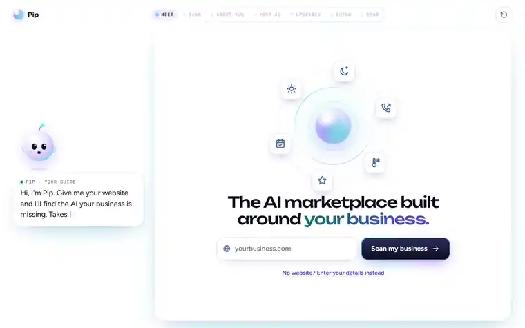
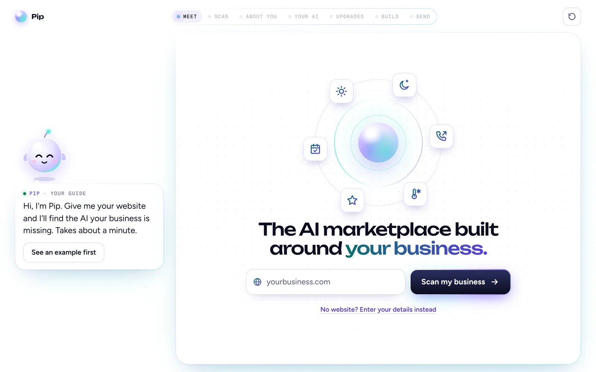
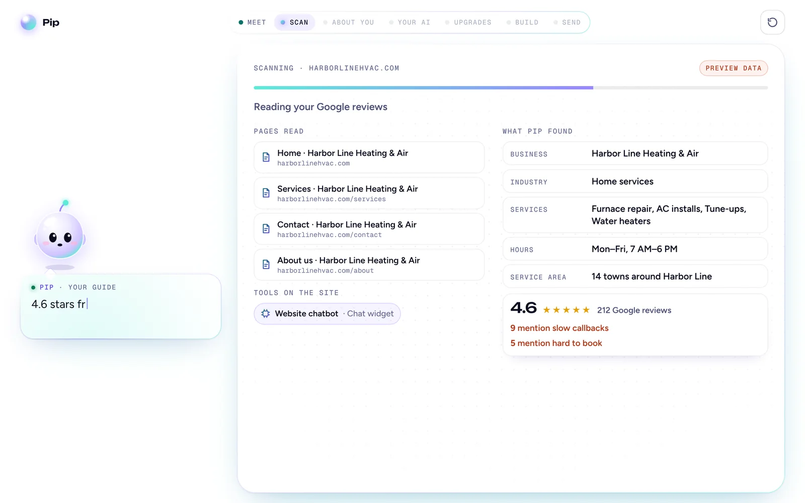
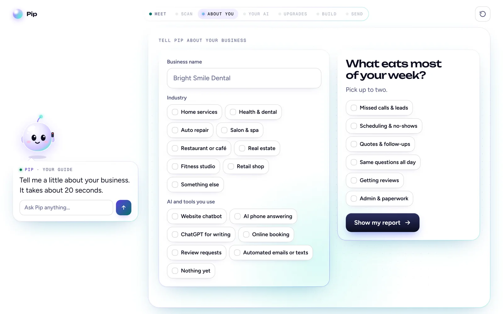
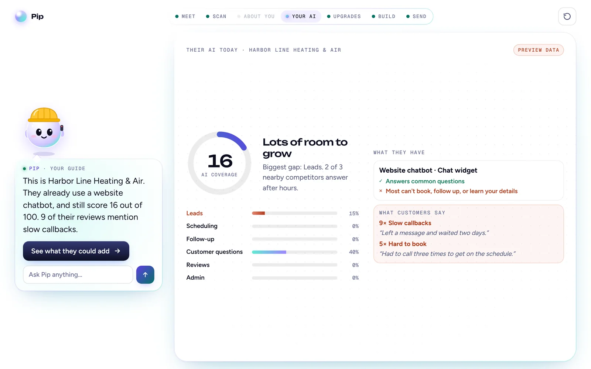
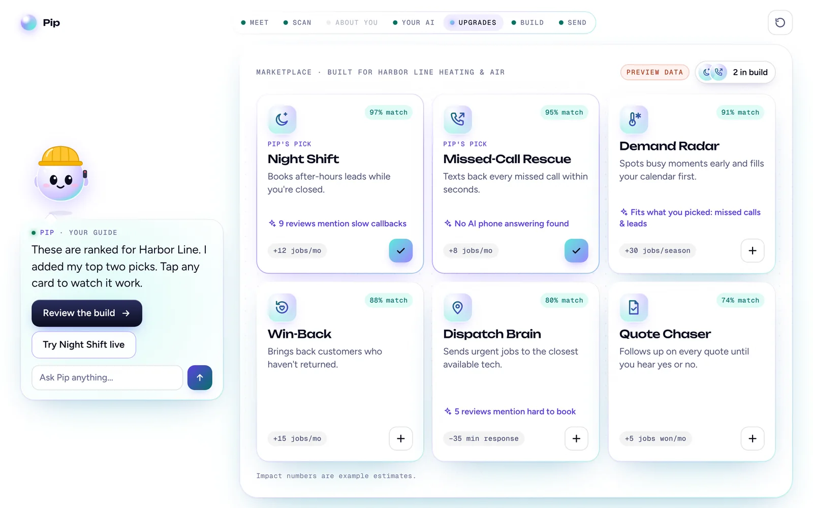
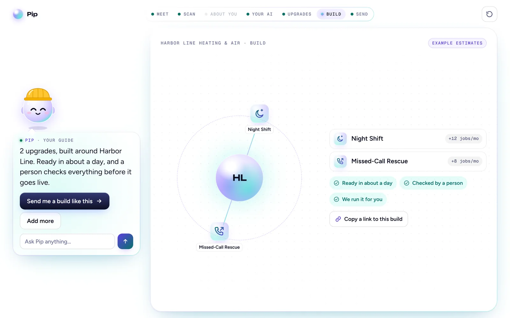
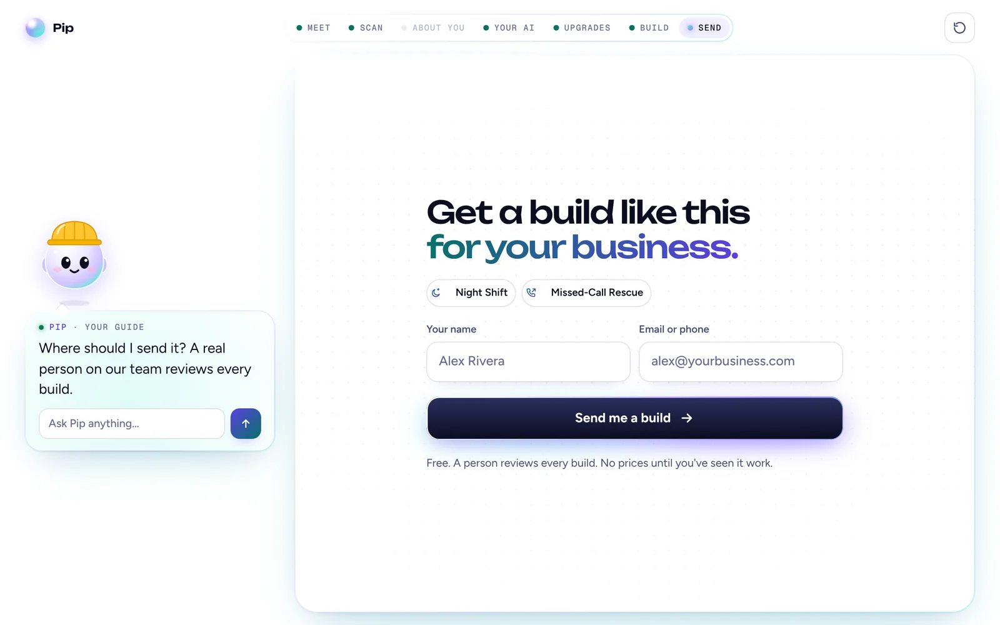
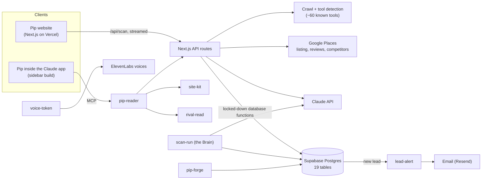

# Pip

**An AI analyst for local businesses.** Give Pip a website. It reads the site, finds the AI tools the business already runs, pulls in its Google reviews and nearby competitors, and ranks the AI upgrades that would help most, each with the evidence behind it.

**[Try it live →](https://pip-ai-drab.vercel.app)**&nbsp;&nbsp;·&nbsp;&nbsp;Click "See an example first" for a walkthrough that runs without a scan.



Status: live, no paying customers yet.

## Who it's for

Owners of local businesses: home services, dental offices, salons, auto shops and the like. In about a minute, Pip shows which AI would help their business and why, using their own site, reviews and competitors.

## The flow

Seven steps, led by Pip, an animated glass guide who talks the owner through each one.

<table>
  <tr>
    <td width="50%" valign="top"><br><b>1. Meet.</b> The owner types their website, or enters details if they don't have one.</td>
    <td width="50%" valign="top"><br><b>2. Scan.</b> Pip reads the homepage and up to 5 key pages, then streams what it finds as it goes.</td>
  </tr>
  <tr>
    <td valign="top"><br><b>3. About you.</b> The owner fixes anything Pip got wrong and picks up to two things that eat their week.</td>
    <td valign="top"><br><b>4. Your AI.</b> A coverage score across six areas, the tools they already have, and what customers complain about.</td>
  </tr>
  <tr>
    <td valign="top"><br><b>5. Upgrades.</b> Upgrades ranked by match %. Every pick shows the review or gap that earned it.</td>
    <td valign="top"><br><b>6. Build.</b> The owner's package, with a link they can share.</td>
  </tr>
  <tr>
    <td valign="top"><br><b>7. Send.</b> Name and contact. A person reviews every build before anything goes live.</td>
    <td valign="top"></td>
  </tr>
</table>

<sub>Screenshots show the built-in example business and its preview data, taken from a local build of this repo.</sub>

## How it works



A scan runs in two steps:

1. **Gather** (`lib/server/gather.ts`) crawls the site, detects tools, and pulls the Google listing, up to 5 recent reviews and nearby competitors. It makes no model calls, so the result is cheap to cache and replay.
2. **Personalize** (`lib/server/personalize.ts`) has Claude turn those facts into a profile and the words Pip says about this one business.

`lib/engine.ts` then scores coverage, ranks the upgrades and writes the evidence lines. The scan streams to the browser as newline-delimited JSON and is cached in Supabase for 7 days. A `?r=` share link restores the full report and build. The Supabase edge functions are described in [`supabase/README.md`](supabase/README.md).

## Key decisions

- **Facts first, model second.** Gathering uses no model at all. Claude only writes the words, and Pip still works on facts alone without an API key.
- **The model can't invent numbers.** Any sentence Claude writes that cites a number not found in the source material is dropped. A review theme can't claim more mentions than reviews Pip read, and a quote is kept only if it appears in the source.
- **Plain code ranks.** Match % comes from rules: a pain the owner named, how uncovered that area is, tools they already run, and complaints in their reviews. Ranks are spread so there are no ties, and every pick carries the line that explains it.
- **Stand-in data is labeled.** Every response says whether it's `live` or `preview`, and the UI shows a "Preview data" chip whenever it isn't live.
- **One place talks to a model.** `lib/server/llm.ts` holds every Claude call. It logs tokens and cost per call, caches the system prompt, and returns `null` on failure, so every caller has a fallback.
- **Fail soft.** Google Places and storage calls return `null` instead of throwing, so a scan never fails because one service did.
- **The public key can't touch data.** The server reaches Supabase only through database functions that require a server secret.

## In progress

The Brain (`supabase/functions/scan-run`) is a staged scan job. Claude proposes AI agents built from a 63-part library of primitives, and deterministic code, not the model, scores them. Each stage runs in its own call, with budget caps per scan, per month and per IP address.

## Run it locally

```bash
npm install
cp .env.example .env.local   # every key is optional
npm run dev                  # http://localhost:3000
```

With no keys, the example walkthrough and a facts-only scan work. `ANTHROPIC_API_KEY` adds the personalized report and Ask Pip. `GOOGLE_PLACES_API_KEY` adds reviews and competitors. The Supabase variables add caching and leads.

```bash
npm run typecheck
npm run build && npm start
```

## Where things live

| Path | What it is |
|---|---|
| `components/PipApp.tsx` | Scene state machine, Pip's lines, scan streaming, share links |
| `components/views.tsx` | One view per step |
| `components/Pip.tsx`, `Bubble.tsx` | The guide and its speech bubble |
| `components/demos.tsx` | Animated demos and the live "you're the customer" chat |
| `lib/engine.ts` | Coverage score, ranking, match %, evidence lines |
| `lib/knowledge.ts` | Upgrades, tools, pains and 8 industries |
| `lib/server/` | Crawl, tool detection, Google Places, personalization, caching, model calls |
| `lib/skills/` | Skill specs, the runtime that runs them, setup questions |
| `app/api/` | API routes; the contract is in [`docs/API.md`](docs/API.md) |
| `sidebar/` | A build of Pip that runs inside the Claude app on the viewer's own plan |
| `supabase/functions/` | Edge functions: lead alerts, voice, site and rival reads, the Brain, the Forge |

## Stack

Next.js 16 · React 19 · TypeScript · plain CSS · Supabase (Postgres and Deno edge functions) · Claude API · Google Places API · ElevenLabs · Resend · Vercel

---

This repo starts from the code running on the live site on November 12, 2026. Source is shared for review; see [LICENSE](LICENSE).
